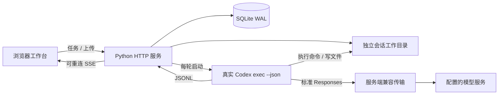

# 架构与关键取舍

## 状态与一致性

会话、消息、任务和事件分别建表，SQLite WAL 支持读写并发。用服务端锁将「检查同会话互斥 / 全局并发额度」与创建任务放在同一临界区，避免双击发送产生两个并行写目录的进程。不同会话最多同时两个任务，超出额度明确返回 429，不悄悄丢弃任务。

任务从 `running` 结束为 `completed` / `failed` / `cancelled`；服务启动将残留 `running` 改为 `interrupted`。只有 CLI 正常退出、出现 `turn.completed`，且生成助手回复时才记成功。模型服务或 CLI 的失败事件会保存在事件流和任务错误字段中。结束前保存消息，再发 `done`，前端收到后重新读取一致快照。

事件先持久化再推送。SSE 使用递增事件 ID、`after` 和 `Last-Event-ID` 支持重连，客户端也按 ID 去重；页面关闭不拥有任务进程的生命周期。输入草稿在会话切换期间保留于前端内存，刷新页面会丢弃未发送草稿。

每个会话有 `workspace/uploads`、`workspace/artifacts`，CLI 配置和本地状态在旁边的 `control/` 中，HTTP 文件接口只能读取 workspace。前端输出先转义再做有限 Markdown 格式化；模型文本不作为可信 HTML 注入。HTML 成果使用 iframe sandbox 和单独 CSP 预览，禁止同源能力、网络请求和表单。

## 为什么不用原生 resume

选用每轮新建 CLI 进程，显式重放有限对话和保留文件，使服务接入不依赖模型提供方的远端会话状态，也避免旧进程失败后的恢复歧义。成本是较长对话重放费用和有限上下文；未实现长期记忆摘要。README 明确写出 24 条 / 80,000 字符边界。

## 为什么保留真实 CLI

服务只负责任务编排、事件解释、持久化和文件出口；不是自行实现函数调用循环。即使兼容层过滤掉不受服务支持的可选工具，命令选择、工具执行、后续模型回合仍在官方 Codex CLI 内进行。默认兼容模式将完整真实模型响应转换成标准 SSE 事件，不修改文本或工具参数；工具执行进度仍通过应用自己的 SSE 实时发送。演示记录可查看实际命令、工具输出、退出码及生成文件。

## 安全范围

单用户、本机访问为设计前提。容器非 root，不挂 Docker socket，不自动继承用户的 Codex 登录、MCP 配置、Hooks 或 shell 环境。兼容模式下上游密钥只留在服务端，不作为 CLI 或工具进程的环境变量；随机内部令牌每次服务启动更新。

这不能防止同容器恶意代码利用共享用户身份读取进程或其他目录，因此没有把它宣称为多租户安全沙箱。公共访问、多用户或不可信代码执行需要分离任务容器、独立身份、只读根文件系统和网络策略。
