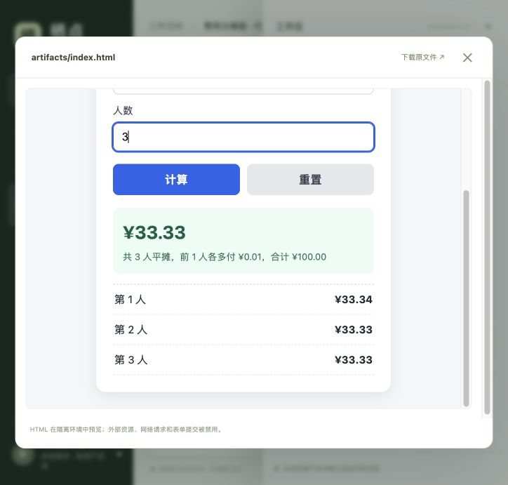

# 实际演示路线

演示使用真实 Codex CLI 和题目提供的模型服务。销售 CSV 完全虚构，不含任何用户私有资料。完整提示词与执行顺序保存在 `scripts/demo.py` 中。

## 1. 代码开发

新建「费用分摊器 · 代码开发」会话，要求创建离线中文费用分摊网页，支持总金额、人数、输入校验，并运行测试。

在「执行记录」看真实命令与输出，在「成果文件」点 `artifacts/index.html` 直接预览，或下载后离线打开。

随后在同一个会话追加：「用整数分计算，余数从第一人开始分配；100 元分给 3 人为 33.34 / 33.33 / 33.33，增加重置按钮并更新验证。」

观察同一个 HTML 文件被修改，原对话和文件继续保留。

## 2. 日常工作与多会话

代码任务执行期间，新建「销售复盘 · 材料分析」会话，上传 `sales.csv`，要求使用 Python 计算月度和渠道收入、成本、毛利及毛利率，生成 Markdown 报告和 CSV 汇总。

随后追加负责人行动摘要，要求明确数据局限和未来两周建议。切回代码会话，可以继续查看其进展与成果。

销售输入的独立期望值：

| 指标 | 期望 |
| --- | ---: |
| 总收入 | 72,000 |
| 总成本 | 45,000 |
| 毛利 | 27,000 |
| 整体毛利率 | 37.5% |
| website 收入 / 成本 / 毛利 | 45,000 / 24,500 / 20,500 |
| marketplace 收入 / 成本 / 毛利 | 27,000 / 20,500 / 6,500 |

## 独立复核后的追加修复

代码会话中间一轮触及 600 秒任务上限，被正确标记为失败，文件继续保留。独立 Node 复核发现三个边界/文案缺陷：`.` 被当作金额、超大整数金额未拒绝、余数说明把余数总分值写成每人额外金额。通过同一会话提交具体反馈后，真实 CLI 修复了三处并完成定向测试。随后浏览器实测发现按钮 `id=reset` 遮蔽原生表单 `reset()`，再次在同一会话追加反馈并修复。真实浏览器中的重置恢复已通过；独立 DOM 桩也补充了命名属性行为。最终独立检查 17 项全部通过，其中金额守恒检查遍历 1000 组输入。

这部分展示了失败状态、保留成果、继续交流及反馈修正，而非只展示一次成功回答。原始事件和真实失败状态均保留在 transcript 与 manifest 中。

## 3. 持久化和异常

- 刷新**工作台**页面或关闭后重新打开，确认两个会话、对话、执行记录及文件仍存在。不要刷新考试监考页面。
- 启动一个耗时任务并点击「停止」，观察任务标为已停止，已有成果不被删除。
- 模型配置不完整时首页给出环境提示；API 返回错误时执行记录和任务状态会标明失败。
- Docker 容器重启后，已完成历史继续保留；运行中的任务改为已中断，可通过新的消息继续。

## 证据入口

`evidence/real-demo/manifest.json` 记录真实模型、会话 ID、开始结束时间和导出文件 SHA256；`code-transcript.json` / `report-transcript.json` 保存对话、执行事件与任务状态。对应目录保存实际生成的文件。

运行证据的状态与复核结果以 [VALIDATION.md](../evidence/VALIDATION.md) 为准。自动化接口测试使用夹具，与真实模型演示严格区分。
